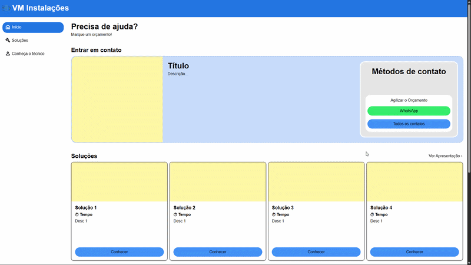

# VM Instalações

Um sistema web moderno e responsivo desenvolvido para a **VM Instalações**, focado em otimizar o fluxo de atendimento, apresentação de soluções técnicas e pré-orçamentos automatizados (Autoatendimento) na região metropolitana de Porto Alegre.

[Acessar Página Oficial](https://vm-instalacoes.vercel.app/) · [Ver Planejamento (Miro)](https://miro.com/app/board/uXjVHeS00ek=/?share_link_id=874937365)

---

## 🛠️ Tecnologias e Arquitetura

O projeto foi construído utilizando ferramentas modernas de mercado, priorizando performance, componentização e tipagem estática:

| Tecnologia | Descrição |
| :--- | :--- |
|  | Estruturação semântica da aplicação |
|  | Estilização avançada com Flexbox e CSS Grid |
|  | Manipulação de DOM e eventos assíncronos |
|  | Tipagem estática robusta para o carrossel e módulo de Autoatendimento |
|  | Empacotador e ambiente de desenvolvimento ultrarrápido |
|  | Pipeline de CI/CD para deploy contínuo |

---

## 🎯 Funcionalidades Principais

* **Navegação Fixa Inteligente (`Sticky Sidebar`):** Menu lateral responsivo que acompanha a rolagem da página para melhor usabilidade em desktops.
* **Vitrine de Soluções:** Grade dinâmica estruturada em CSS Grid apresentando os serviços prestados.
* **Módulo de Autoatendimento (Em desenvolvimento):** Lógica em TypeScript para filtragem e construção interativa de pré-orçamentos baseados em dados estruturados.
* **Design Responsivo:** Layout adaptado para diferentes tamanhos de tela (Mobile e Desktop) seguindo rigorosamente o protótipo de UI/UX planejado.

### Veja abaixo uma demonstração sobre como o projeto está:
> Esta gravação é da **versão de desenvolvimento** `v.0.3.0`.

  

